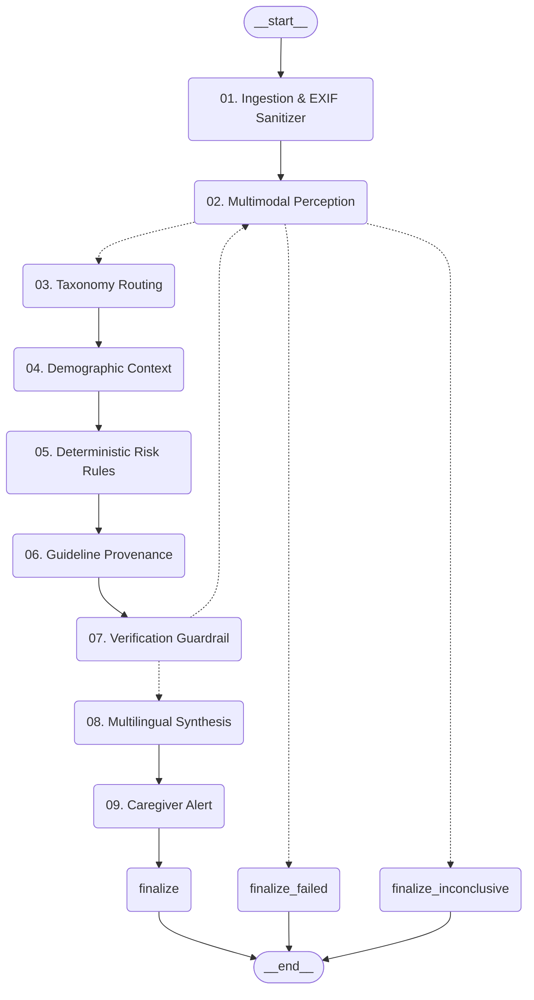

# Sentinel Lens v2.0 — Autonomous Multimodal Hazard Advisor

[](#6-testing--verification)
[](#6-testing--verification)
[-blue.svg)](#5-evaluation-benchmark-s-35)
[](#2-9-agent-compiled-langgraph-pipeline)
[](#3-quick-start)
[](#license)

**Sentinel Lens v2.0** is an autonomous, multimodal physical safety and hazard advisory system built on an auditable 9-agent compiled **LangGraph** execution pipeline and a mobile-first **Terminal Ember** user interface.

Point your camera at any indoor or outdoor environment—via live camera feed, captured video, or still photo—and receive an auditable, structured catalog of every detectable physical hazard tailored to who is at risk (**Baby**, **Child**, **Adult**, **Elderly**), complete with actionable mitigation guidelines, coverage gap disclosures, and strict zero false-safe guarantees.

---

## 🌟 Key Features

* **🤖 9-Agent LangGraph Pipeline**: Ingestion & EXIF Sanitizer → Scene Perception → Hazard Taxonomy Routing → Demographic Reachability → Deterministic Risk Prioritization → Guideline Provenance → Verification Guardrail → Report Synthesis → Caregiver Dispatch.
* **⚡ Real-Time Active Agent Telemetry**: Both the live viewfinder HUD overlay and the pipeline status strip display the active agent, title, role, and current subtask in real time.
* **🌐 Instant Trilingual Switching**: Switch between **English**, **Kannada (ಕನ್ನಡ)**, and **Hindi (हिन्दी)** with zero latency. All UI labels, hazard taxonomy, and risk levels update immediately without rescanning.
* **📄 Full Multi-Page Trilingual PDF Report**: Print or export comprehensive diagnostic reports featuring side-by-side English, Kannada, and Hindi translations, auditable rule IDs, guideline citations, and Rule R1 disclaimers.
* **📱 Mobile-First Terminal Ember UX**: Designed for touch devices with dynamic viewport height (`100dvh`), large touch targets (≥ 48px), and 3-snap bottom sheets (`peek`, `half`, `full`).
* **🚀 Turnkey Deployment (No npm Required)**: Ships with pre-compiled frontend distribution and native launchers for Windows (`SentinelLens.exe`, `SentinelLens.bat`) and Linux/macOS (`run_app.sh`).

---

## 1. Product Promise & Core Invariants

Sentinel Lens replaces black-box probabilities and model hallucinations with an auditable rule engine, deterministic taxonomy classification, and verification critics.

### Three Evidence Tiers (Never Guessing)
* **Observed**: Directly visible hazard with ≥ 1 specific factual evidence statement naming visible objects.
* **Likely**: Partially visible or strongly implied by visible context with documented justification for partial visibility.
* **Possible (Check This)**: A hazard class that could exist due to a visible trigger object (e.g. electrical power strip beside a water basin). A named trigger object is mandatory; possible items without a visible trigger are strictly dropped.
* **Coverage Gaps**: Clear accounting of blurry, dark, cropped, or obscured areas that could not be assessed.

### Non-Negotiable Contract Guardrails (R1 – R14)
* **Rule R1 (Zero False-Safe)**: A failed or unreliable analysis is never shown as safe. Outcomes are strictly: `hazards_found`, `none_observed`, `inconclusive`, `failed`. User-facing text never says *"safe"*, *"no danger"*, or *"all clear"*; the standardized formulation is **"No hazards observed in this view"**.
* **Rule R2 (Evidence Before Claim)**: No hazard without an evidence string; no `possible` hazard without a named visible trigger object.
* **Rule R3 (Fact / Assumption Separation)**: Directly observed visual evidence and model assumptions reside in separate schema fields.
* **Rule R4 (Auditable Ordinal Rules)**: Risk levels are strictly ordinal (`low`, `medium`, `high`, `uncertain`). Model evidence strength is categorical (`clear`, `partial`, `weak`). No hallucinated percentages.
* **Rule R5 (Rule Engine Transparency)**: The risk assessment is described as an auditable rule engine, never as a trained or predictive model.
* **Rule R6 (Person Category as Input)**: Person profile is an explicit user selection, never inferred from images. No biometric or medical diagnoses.
* **Rule R7 (Approximate Regions)**: No false precision; bounding areas are approximate and labelled as such.
* **Rule R8 (Precaution Provenance)**: Every precaution carries its provenance (`guideline` or `generic`); no invented standards.
* **Rule R9 (Secret Isolation)**: `GEMINI_API_KEY`, `TELEGRAM_BOT_TOKEN`, and `TELEGRAM_CHAT_ID` reside solely in backend `.env`. Never exposed in frontend code, API payloads, or logs.
* **Rule R10 (Bounded Execution)**: Bounded retries (default 1), 5-second hard cap on Telegram alerts, single in-flight frame per session.
* **Rule R11 (Periodic Sampling Disclaimer)**: Live camera and video analyses carry explicit disclaimers: *"Periodic frame sampling. Events between frames can be missed."*
* **Rule R12 (Privacy by Default)**: Images are never retained on disk; EXIF/GPS metadata is stripped in memory upon ingest.
* **Rule R13 (Translation Resilience)**: Translation failures gracefully fall back to canonical English with `translation_error` flagged.
* **Rule R14 (Authentic Execution Traces)**: UI agent states reflect authentic LangGraph execution events only, never synthetic timers.

---

## 2. 9-Agent Compiled LangGraph Pipeline



### Agent Roster

| # | Agent Name | File | Primary Responsibility |
|---|---|---|---|
| **01** | **Ingestion & EXIF Sanitizer** | `app/utils/image_ingest.py` | Validates format, strips EXIF/GPS telemetry for privacy, and enforces dimension limits. |
| **02** | **Multimodal Scene Perception** | `app/agents/scene_perception.py` | Visual observation, environmental assessment, and checklist sweeps. |
| **03** | **Hazard Taxonomy Routing** | `app/agents/hazard_classifier.py` | Maps findings to 15 taxonomy categories (`H01`–`H15`), merges duplicates via token Jaccard similarity. |
| **04** | **Demographic Reachability** | `app/agents/person_context.py` | Applies vulnerability and physical reachability modifiers for Baby, Child, Adult, Elderly. |
| **05** | **Deterministic Risk Prioritization** | `app/agents/risk_assessor.py` | Pure, idempotent rule engine evaluating clearances, water-elec matrices, and fall heights. |
| **06** | **Guideline Provenance & Citations** | `app/agents/safety_knowledge.py` | Retrieves actionable precautions with auditable guideline provenance codes. |
| **07** | **Verification & Guardrail** | `app/agents/verification.py` | Audits evidence claims (V1–V8), eliminates triggerless items, enforces Rule R1 fail-closed contract. |
| **08** | **Safety Report Synthesis** | `app/agents/safety_report.py` | Multilingual report synthesis across English, Kannada, and Hindi with forbidden phrase guards. |
| **09** | **Caregiver Notification & Dispatch** | `app/agents/caregiver_notification.py` | Telegram alerts with SHA-1 fingerprinting, emergency thresholds, and 900s cooldown policy. |

---

## 3. Quick Start

### Option A: Windows Executable (Zero Setup)
Double-click `SentinelLens.exe` or `SentinelLens.bat`.
* Automatically discovers Python (`.venv`, `venv`, or system `python.exe`).
* Starts the backend server and opens your browser directly at `http://localhost:8000`.

### Option B: Linux / macOS Universal Script
```bash
chmod +x run_app.sh
./run_app.sh
```

### Option C: Manual Setup (Python Only)
```bash
# 1. Clone repository
git clone https://github.com/your-username/sentinel-lens.git
cd sentinel-lens

# 2. Setup virtual environment
python3 -m venv .venv
source .venv/bin/activate    # Linux / macOS
# .\.venv\Scripts\activate   # Windows

# 3. Install dependencies
pip install -r requirements.txt

# 4. Configure environment
cp .env.example .env
# Add your free Gemini API key to .env: GEMINI_API_KEY=your_key_here

# 5. Start Sentinel Lens
python -m uvicorn app.api:app --host 0.0.0.0 --port 8000
```
Open **`http://localhost:8000`** in your browser. The pre-compiled frontend is served automatically.

---

## 4. Frontend Development (Optional)

The production web assets are pre-built in `frontend/dist/`. If you wish to modify the React frontend:

```bash
cd frontend
npm install
npm run dev -- --host
```

---

## 5. Evaluation Benchmark (S-35)

Sentinel Lens includes an offline evaluation harness (`evaluate_hazards.py`) benchmarking recall, precision, false-safe rate, and latency across labelled test scenes:

```bash
python evaluate_hazards.py
```

| Metric | Measured Value | Target | Status |
|---|:---:|:---:|:---:|
| **False-Safe Rate** | **0.0%** | **0.0% (Rule R1 Critical)** | **PASS** |
| **Overall Recall** | **100.0%** | ≥ 90.0% | **PASS** |
| **Overall Precision** | **100.0%** | ≥ 85.0% | **PASS** |
| **Failure Rate** | **0.0%** | < 5.0% | **PASS** |
| **Outcome Accuracy** | **100.0%** | ≥ 95.0% | **PASS** |
| **Mean Latency** | **27.0 ms** | < 2000 ms (offline) | **PASS** |

Full evaluation report available at [`docs/eval/eval_report.md`](file:///home/blue/anup/docs/eval/eval_report.md).

---

## 6. Testing & Verification

Run the full automated test suites:

```bash
# Backend test suite (209 tests)
pytest tests/ -v

# Frontend test suite (60 tests)
cd frontend && npm test -- --run
```

---

## 7. Disclaimers & Operational Limits

1. **Periodic Sampling**: Live camera and video analyses sample periodic frames. Fast-moving events between intervals may not be captured.
2. **Visual Scope**: Assessment is strictly bounded by what is visibly discernible in the camera view. Hidden, occluded, or out-of-frame hazards cannot be evaluated.
3. **Advisory Tool**: Sentinel Lens derives its findings from codified, transparent safety rules (`docs/risk_rules.md`). It is an advisory aid and does not replace professional structural, electrical, or medical inspections.

---

## License

MIT License. See [LICENSE](LICENSE) for details.
