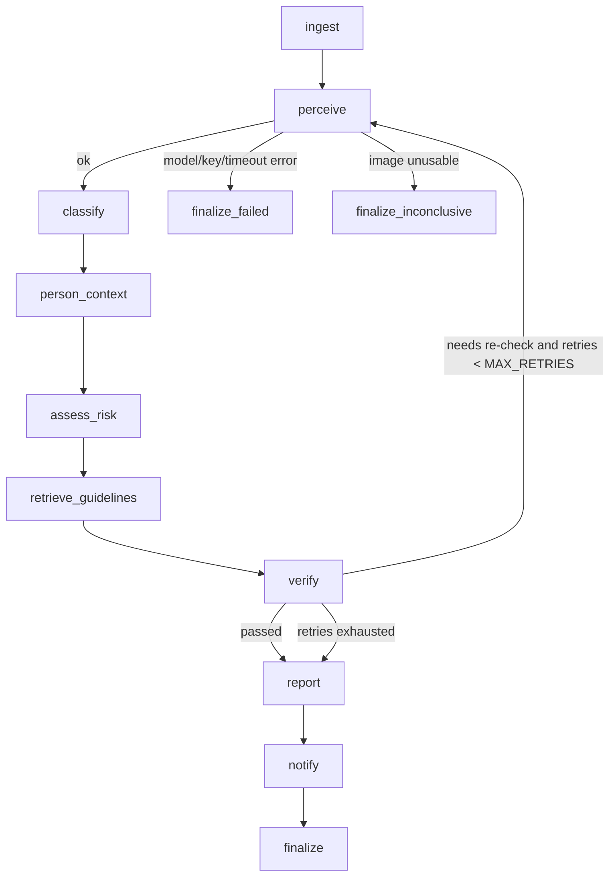

# agent.md — Runtime agents, contracts and build rules

Project: Hazard Precaution Advisor v2 (mobile-first, all-hazard scanning)
Companion files: `skills.md` (reusable capabilities) · `design.md` (UI/UX) · `implementation_plan.md` (phases, tasks, tests)

---

## 1. Product promise

Point a phone at a scene — a photo, a recorded video, or the live rear camera — and get a structured list of **every hazard that can reasonably be identified from what the camera saw**, tailored to who is at risk (baby, child, adult, elderly), with precautions and an honest account of what could *not* be assessed.

"All possible hazards" is implemented as three evidence tiers, never as guessing:

| Tier | Meaning | Rule to be allowed in the report |
|---|---|---|
| **Observed** | Hazard is directly visible | ≥1 evidence statement naming what is visible |
| **Likely** | Partly visible, or strongly implied by visible context | Evidence + the reason it is only partial |
| **Possible (check this)** | A hazard class that *could* exist because of a visible trigger object, but the image cannot confirm it | A named visible trigger (e.g. "socket next to the sink"). No trigger → the item is dropped |

A fourth output matters as much as the hazards: **coverage gaps** — blurry, dark, cropped, occluded or out-of-frame areas that were *not* assessed.

---

## 2. Non-negotiable rules (apply to every agent and to the coding assistant)

| # | Rule |
|---|---|
| R1 | A failed or unreliable analysis is never shown as safe. Outcomes are exactly: `hazards_found`, `none_observed`, `inconclusive`, `failed`. User-facing text never says "safe", "no danger" or "all clear" — use "No hazards observed in this view". |
| R2 | Evidence before claim. No hazard without an evidence string; no "possible" hazard without a visible trigger. |
| R3 | Observed facts and assumptions are stored in separate fields. |
| R4 | Risk comes from documented, auditable rules (rule IDs are returned). Risk levels are ordinal labels, not probabilities. Model "evidence strength" is categorical (`clear`/`partial`/`weak`), never a calibrated percentage. |
| R5 | The rule engine is described as a rule engine, never as a trained or predictive model. |
| R6 | Person category is a user input. It is never inferred from the image. No medical diagnosis. No claim that a person is present. |
| R7 | No pixel-level localization claims. Regions are shown only if a region estimate is implemented, and are labelled "approximate". |
| R8 | No invented citations or standards. Every precaution carries its provenance (`guideline` or `generic`). |
| R9 | `GEMINI_API_KEY`, `TELEGRAM_BOT_TOKEN`, `TELEGRAM_CHAT_ID` live only in the backend `.env`. Never in frontend code, API responses, or logs. |
| R10 | Everything is bounded: retries (default 1), model calls per request, frames per session, queued frames (never more than one in flight), timeouts. |
| R11 | Video and live analysis are periodic frame sampling. Say so in the UI and report: events between frames can be missed. |
| R12 | Privacy by default: images/frames are not stored; EXIF/GPS is stripped; the user is told what is sent to Gemini and when. |
| R13 | A failed translation returns the English report plus a `translation_error`. Never fabricate a translation. |
| R14 | UI agent/pipeline state reflects real execution events only. |

---

## 3. Rules for the AI coding assistant building this

1. **Inspect first.** Read the repo (agents, graph, state, API, guidelines JSON, tests, requirements, `evaluate_hazards.py`) before writing code. Write `docs/audit.md`.
2. **Do not delete the old implementation** until the new one is verified. Use a branch, small commits, and a `PIPELINE_VERSION=v2|legacy` switch.
3. **Never ask for or print `.env` contents.** Reference variable names only. Keep `.env.example` secret-free.
4. **Do not commit or push without explicit permission.** At the end of each phase, propose the commit message and ask.
5. **Do not claim anything unexecuted passed.** Report real test output. If Gemini/Telegram credentials are missing, say the end-to-end run was not possible.
6. **No fabricated data**: no fake sample output in the UI, no simulated agent progress, no placeholder accuracy numbers.
7. **Module-name collisions:** `app/api.py` + `app/api/` (and `app/graph.py` + `app/graph/`) cannot coexist — the package shadows the module and breaks `uvicorn app.api:app`. Keep `app/api.py` as the entry point and use `app/routes/` and `app/pipeline/` for new code.
8. **Windows-first commands** (PowerShell, `.venv`). No Docker/WSL requirement.
9. Pin versions to what `pip`/`npm` resolve at install time and record them; check current docs for the Gemini SDK and model name instead of assuming.
10. External services (Gemini, Telegram, translation) sit behind interfaces with fakes, so every agent is testable offline.

---

## 4. Architecture

### 4.1 Pipeline (per image or frame)



`ingest` and `finalize_*` are plumbing nodes, not agents. The diagram shipped in the README must be **generated from the compiled graph** (`workflow.get_graph().draw_mermaid()`), and a test must fail if node names in the doc and in the graph differ.

### 4.2 Session layer (video, live, room sweep)

Agent 9 (Session Aggregator) sits *outside* the per-frame graph. The frontend sends one frame at a time through the pipeline and the aggregator merges the per-frame results into a session summary.

### 4.3 Typed state

```python
class PipelineState(TypedDict):
    request: AnalysisRequest              # person_category, language, mode, source, session_id, frame_ts
    image: PreparedImage | None
    perception: PerceptionResult | None
    hazards: list[Hazard]
    person_context: dict[str, PersonContext]     # keyed by hazard id
    risks: dict[str, RiskAssessment]
    precautions: dict[str, list[Precaution]]
    verification: VerificationResult | None
    report: SafetyReport | None
    notification: NotificationRecord | None
    retries_used: int
    retry_focus: list[str]                # hazard ids / categories to re-check
    errors: Annotated[list[ErrorInfo], operator.add]
    trace: Annotated[list[TraceEvent], operator.add]
    outcome: Outcome | None
```

### 4.4 Execution events (for the UI)

Events come from the graph's own streaming (`astream`, `stream_mode="updates"`) plus a `@traced` node wrapper — never from timers.

```json
{"type": "node_started | node_finished | node_failed | retry | preview | result | error",
 "node": "perceive", "attempt": 1, "ts": "2026-11-01T10:15:02Z",
 "duration_ms": 0, "summary": "3 candidate hazards, 2 coverage gaps"}
```

`preview` carries the classified hazard list tagged `unverified: true` so the UI can show it early without presenting it as final.

---

## 5. Shared contracts

### 5.1 Enums

```text
PersonCategory   baby | child | adult | elderly
Language         en | kn | hi
Mode             quick | deep
Source           photo | frame | video_frame
HazardStatus     observed | likely | possible
EvidenceStrength clear | partial | weak
RiskLevel        low | medium | high | uncertain
Outcome          hazards_found | none_observed | inconclusive | failed
VerifyStatus     passed | passed_with_changes | failed_fallback
NotifyStatus     sent | skipped_cooldown | skipped_policy | disabled | failed
```

### 5.2 Hazard taxonomy (category IDs)

| ID | Category | Examples (only when visible) |
|---|---|---|
| H01 | slip_wet | wet/shiny floor, spills, soap residue, loose rug |
| H02 | trip_clutter | objects in walkways, loose cables on floor, uneven threshold |
| H03 | electrical | exposed wiring, damaged cable, overloaded socket strip, socket near water, uncovered sockets |
| H04 | fire_heat | open flame, stove/burner, hot appliance, hot liquid, flammables near heat, gas cylinder/regulator, smoke |
| H05 | sharp_glass | knives, broken glass, exposed blades, sharp edges |
| H06 | fall_height | stairs without guard, balcony/window edge, ladder, open drain or pit, raised ledge |
| H07 | unstable_falling | tall unanchored furniture, TV on a narrow stand, heavy items on high shelves, hanging objects |
| H08 | chemical_poison | medicines, cleaning agents, pesticides, alcohol within reach |
| H09 | choking_small_objects | coins, button batteries, small toy parts, beads, magnets |
| H10 | water_drowning | open bucket/tub/tank with water, pool, pond |
| H11 | strangulation_entrapment | blind/curtain cords, plastic bags, gaps between furniture, ropes |
| H12 | structural_damage | cracks, hanging plaster, damp/mould patches, loose fixtures |
| H13 | poor_visibility | dark stairs/corridors, glare, blocked sight lines |
| H14 | outdoor_traffic_terrain | road/vehicle proximity, potholes, uneven ground, exposed pole wiring |
| H15 | other_observable | anything physical that fits none of the above (marked uncertain) |

The same taxonomy drives the guideline file, risk rules, UI icons and translations. Add categories in one place (`data/taxonomy.json`), not in code.

### 5.3 Final result (what the frontend renders)

```json
{
  "id": "an_20261101_101502_ab12",
  "timestamp": "2026-11-01T10:15:04Z",
  "outcome": "hazards_found",
  "analysis_reliable": true,
  "person_category": "child",
  "language": "en",
  "scene": {
    "environment": "kitchen",
    "summary": "Kitchen counter with a kettle and a power strip near the sink.",
    "quality_flags": ["slightly_dark"],
    "coverage_gaps": ["Left third of the frame is out of focus", "Floor not visible"]
  },
  "hazards": [
    {
      "id": "hz_1",
      "category_id": "H03",
      "title": "Power strip close to the sink",
      "status": "likely",
      "evidence_strength": "partial",
      "evidence": ["A multi-socket strip sits on the counter a hand-width from the sink basin"],
      "trigger": null,
      "region": null,
      "person_relevance": "high",
      "risk": { "level": "high", "potential_level": null, "rule_ids": ["R-BASE-H03", "R-COMBO-WATER-ELEC"], "rationale": "Electrical item near a water source; children can reach counters." },
      "precautions": [
        { "text": "Move the strip away from the sink and keep it dry.", "provenance": "guideline", "guideline_id": "G-H03-002", "priority": 1 }
      ]
    }
  ],
  "overall_risk": "high",
  "immediate_action": false,
  "verification": { "status": "passed", "issues": [], "changes": [], "retries_used": 0 },
  "notification": { "status": "sent", "reason": "high risk, child, partial evidence" },
  "errors": [],
  "translation_error": null,
  "trace": [ { "node": "perceive", "status": "ok", "duration_ms": 0 } ],
  "limits": "Based on one still image. Hazards outside the frame or hidden from view are not assessed."
}
```

(`duration_ms` values come from real runs; zeros here are placeholders in the contract only.)

---

## 6. Agents

All agents are plain functions/classes with typed input and output, no hidden global state, and injected services. Each lives in `app/agents/<name>.py` and is wrapped into a graph node in `app/pipeline/workflow.py`.

### Agent 1 — Scene Perception (`scene_perception.py`)

**Purpose:** Understand the visible environment and list candidate hazards with evidence.
**Input:** `PreparedImage`, `mode`, optional `retry_focus`.
**Output:** `PerceptionResult` — `environment{label, confidence_band}`, `scene_summary`, `objects[]`, `candidate_hazards[{raw_title, category_hint, description, evidence[], trigger?, visibility}]`, `checklist[{category_id, finding: present|absent|cannot_see, evidence}]`, `quality{blur, darkness, glare, framing}`, `coverage_gaps[]`, `errors[]`.

Rules
- Person-agnostic on purpose: it reports hazards for *everyone*; person category is applied later. This keeps the list complete.
- Two sections in one structured call (**quick**): open observation, then a category **checklist sweep** using the environment checklist from `data/hazard_checklists.json`. `cannot_see` feeds coverage gaps, never hazards.
- **deep** mode adds overlapping 2×2 tile calls (capped by `DEEP_SCAN_MAX_CALLS`) and merges results.
- Only describe what is visible. Each candidate hazard needs evidence text; assumptions go in a separate `assumptions` field.
- Non-scene inputs (screenshots, documents, blank frames) → `inconclusive`.
- Optional region estimate (if the configured Gemini model supports bounding boxes — verify in current docs): stored as normalised approximate boxes; UI labels them "approximate".

Fails closed
- Missing key, quota/429, timeout, safety-block, or invalid JSON after **one** repair attempt → `errors[]` populated, outcome `failed`. Never an empty hazard list.

Tests: schema validity with a fake vision service; invalid-JSON repair path; blocked-response path; missing-key path; non-scene image path.

### Agent 2 — Hazard Classification (`hazard_classifier.py`)

**Purpose:** Turn raw candidates and checklist hits into normalised, de-duplicated hazards.
**Input:** `PerceptionResult`. **Output:** `list[Hazard]` (category, normalised title, status, evidence strength, evidence, trigger, `dropped[]` audit list).

Rules
- Deterministic: validate `category_hint`, else keyword map from `taxonomy.json`, else `H15` marked uncertain.
- Merge duplicates: same category + shared primary object or token overlap ≥ configured threshold; union the evidence.
- A checklist `present` with no matching candidate becomes a hazard from its evidence.
- Status: clear direct evidence → `observed`; partial/contextual → `likely`; trigger-only → `possible`. **Possible without a trigger is dropped** and listed in `dropped[]` (visible in the trace, not in the report).
- Cap `possible` items per image (default 8), ordered by category severity, so "worth checking" does not become noise.

Tests: duplicate merge, trigger gate, category fallback, checklist-only hazard, possible cap.

### Agent 3 — Person Context (`person_context.py`)

**Purpose:** Describe how each hazard affects the selected person category.
**Input:** hazards + `PersonCategory`. **Output:** `dict[hazard_id, PersonContext]` — `relevance (high|normal|low)`, `vulnerability_factors[]`, `severity_modifier (−1..+2)`, `note`.

Rules
- Static, reviewable table `data/person_profiles.json` (mobility, reach/height, ability to recognise hazards, mouthing behaviour, injury severity). Examples: baby × H09 → +2; elderly × H01 → +2; child × H03 → +1; adult × H09 → relevance low.
- **Never drop a hazard because it is low-relevance.** It stays in the list, ordered lower. This is how the report stays "all hazards".
- No diagnosis, no inference that anyone is in the scene.

Tests: table coverage (every category × every person), modifier bounds, unknown category fallback.

### Agent 4 — Risk Assessment (`risk_assessor.py`)

**Purpose:** Assign Low / Medium / High / Uncertain with a stated reason.
**Input:** hazards, person context. **Output:** `dict[hazard_id, RiskAssessment]` — `level`, `potential_level`, `rule_ids[]`, `rationale`, `recommend_reanalysis`, `recommend_human_check`, plus `overall_risk` and `immediate_action`.

Rules (documented in `data/risk_rules.json`, mirrored in `docs/risk_rules.md`)
1. `score = base_severity(category) + person_modifier + combo_modifier`, clamped to 1–5.
2. Combo rules are explicit and IDed, e.g. `R-COMBO-WATER-ELEC` (H03 with water source visible), `R-COMBO-FLAME-FLAMMABLE`, `R-COMBO-TALL-FURNITURE-CHILD`.
3. Mapping: ≤2 low · 3 medium · ≥4 high.
4. **Evidence gate:** `status=possible` or `evidence_strength=weak` → level becomes `uncertain`, and `potential_level` shows what it would be if confirmed ("check this — could be High").
5. `overall_risk` = highest level among `observed`/`likely` hazards. Only `possible` items → `uncertain`. No hazards and poor coverage → outcome `inconclusive`.
6. `immediate_action` is set only by explicit patterns (visible fire/smoke; visible exposed conductor with visible water). It never claims anyone is in danger.
7. Recompute must be idempotent: the Verification agent re-runs it.

Tests: table-driven cases for each rule ID, gate behaviour, overall aggregation, idempotence.

### Agent 5 — Safety Knowledge (`safety_knowledge.py`)

**Purpose:** Match hazards to precautions from the structured knowledge base.
**Input:** hazards + person category. **Output:** `dict[hazard_id, list[Precaution]]` — `text`, `provenance (guideline|generic)`, `guideline_id?`, `source_note?`, `priority`, `applies_to`.

Rules
- Source of truth: `data/guidelines/safety_guidelines.json` (migrate its schema once, keep every existing entry and its wording).
- Retrieval: category → person filter → priority rank → de-duplicate on normalised text → remove entries listed in each other's `conflicts_with`.
- Fallback tiers: (1) category-level `generic` precautions stored in the same file; (2) a universal "keep people away, remove or avoid the hazard if safe, ask a qualified professional" entry. **No model-written precautions by default** (`ALLOW_AI_GENERAL_PRECAUTIONS=false`); if enabled, they carry `provenance: "ai_general"` and a visible label.
- `source_note` only holds citations the project owner has verified and entered by hand. The assistant must not add standards or organisation names on its own.

Tests: retrieval per category/person, dedupe, conflict removal, fallback tiers, never-empty guarantee for every hazard.

### Agent 6 — Verification and Critic (`verification.py`)

**Purpose:** Review the assessment before the user sees it.
**Input:** full state. **Output:** `VerificationResult{status, checks[], issues[], changes[], retries_used}` and a routing decision.

Deterministic checks first
- V1 every hazard has valid category and ≥1 evidence string.
- V2 observed/likely evidence names an object present in `objects` or checklist evidence (heuristic; failure = flag, not delete).
- V3 recomputed risk equals stored risk.
- V4 every hazard has ≥1 precaution.
- V5 no contradictory precautions.
- V6 outcome `none_observed` only when perception succeeded **and** image quality is adequate.
- V7 every `possible` hazard has a trigger.
- V8 person category and language fields set.

Optional LLM critic (`VERIFIER_USE_LLM`, runs only when V2 flagged or any evidence is weak): second vision call "which proposed hazards are not supported by this image?" → per hazard `supported | unsupported | unsure`.

Actions
- `unsupported` → downgrade to `possible` if a trigger exists, otherwise remove; record in `changes[]`.
- `unsure` → keep, mark `uncertain`.
- If the critic or checks show the perception itself looks wrong (default: more than half the hazards unsupported, or checklist contradicts candidates) → **one** targeted re-perception with `retry_focus`. After `MAX_RETRIES` → continue with `failed_fallback`, the result carries a visible "reduced confidence" note. It never loops and never blocks every result.

Tests: each V-check pass/fail, downgrade vs remove, retry bound, fallback status.

### Agent 7 — Safety Report (`safety_report.py`)

**Purpose:** Produce the final user-facing report from verified data.
**Input:** verified state. **Output:** `SafetyReport` (structured, then rendered by the UI/print view).

Rules
- Built from templates and fields — no new claims are introduced at this stage.
- Order: act-now banner (if `immediate_action`) → confirmed (observed/likely) by risk → "Worth checking" (possible) → coverage and limits → precautions → references → meta (timestamp, person, language, pipeline version).
- Wording rules from R1; always include the limits sentence and the "not a guarantee of safety" statement once, in the footer.
- Language: English is canonical. Kannada/Hindi: fixed vocabulary (category names, risk labels, UI strings) from curated `data/i18n/{kn,hi}.json`; only free-text fields go through `translation_service`. Validate: same item count, no empty strings, IDs/enums untouched. On failure → English + `translation_error` (R13).
- Failure mode: for `failed`/`inconclusive` outcomes it renders a short static message from i18n strings and a retake/retry suggestion. No model call.
- Native-speaker review of the Kannada and Hindi safety wording is recommended before real use.

Tests: ordering, wording guard (forbidden-phrase test), translation validation and failure path, failure-mode rendering.

### Agent 8 — Caregiver Notification (`caregiver_notification.py`)

**Purpose:** Notify the configured caregiver when policy says so.
**Input:** final result + settings. **Output:** `NotificationRecord{status, reason, attempts, telegram_message_id?}`.

Policy (defaults, all configurable)
- Send only if: outcome `hazards_found` **and** analysis reliable **and** ≥1 `observed`/`likely` hazard with evidence ≥ `partial` **and** overall risk ≥ `NOTIFY_MIN_LEVEL` (default `high`; `medium` also qualifies when person is baby/child if enabled).
- Fingerprint = `sha1(category_id + normalised_title + session_or_device_id)`. Cooldown `NOTIFY_COOLDOWN_SECONDS` (default 900). Re-notify only if the same hazard's risk escalates or a new fingerprint appears.
- Message: risk level, ≤3 top hazards, time, person category, language of the caregiver setting. No image attached by default.
- One bounded retry with backoff on network error; 5-second overall cap, executed inline so the recorded status is the real one.
- State in an in-memory TTL map, optionally persisted to `data/runtime/notify_state.json` (git-ignored).
- Logging: set `httpx`/`httpcore` loggers to WARNING — Telegram bot URLs contain the token. Redact tokens in any error text.

Tests: policy matrix, cooldown, escalation, dedupe across frames, disabled/missing-config, Telegram failure and retry bound (all with a fake sender).

### Agent 9 — Session Aggregator (`session_aggregator.py`) — optional, recommended

**Purpose:** Merge per-frame results for video, live monitoring and multi-photo "room sweep".
**Input:** stream of `AnalysisResult` with `view_index` or `frame_ts`. **Output:** `SessionSummary` — merged hazards with `sightings[]`, `first_seen`, `last_seen`, `max_risk`, `change_events[]`, `coverage` (views analysed, gaps).

Rules
- Deterministic matching: same category + token Jaccard ≥ 0.6 (configurable). Same label does not prove it is the same physical object; the UI says "seen in N views".
- `not_seen_recently` (live/video) is not "resolved" — never wording that implies the hazard was fixed.
- Memory bounded: last N results per session, sessions expire.
- Do not describe this as object tracking.

Tests: merge/split cases, bounds, expiry, wording guard.

---

## 7. Failure-mode matrix

| Condition | Behaviour | What the user sees |
|---|---|---|
| Missing/invalid `GEMINI_API_KEY` | `failed`, `errors=[missing_api_key]` | "Analysis couldn't run. This is not a safe result." + setup hint (no key shown) |
| Gemini 429 / quota | Backoff; session slows down; request fails closed after bounded retries | "Rate-limited, slowing down" |
| Timeout | `failed` | Retry button; not marked safe |
| Invalid JSON | One repair attempt, then `failed` | Same as above |
| Model safety block | `failed` with `model_blocked` | Explains the image could not be analysed |
| Image too dark/blurry | `inconclusive` when nothing assessable, otherwise `coverage_gaps` | Retake guidance |
| Not a physical scene | `inconclusive` | "This doesn't look like a scene I can assess" |
| Verification can't reconcile | `failed_fallback`, reduced-confidence note | Report with visible warning |
| Translation fails | English + `translation_error` | "Couldn't translate this report. Showing English." |
| Telegram not configured / fails | `disabled` / `failed` recorded truthfully | Status chip, no false "sent" |
| Client sends overlapping frame | Rejected/skipped client-side; server also returns 429 for a busy session | Frame skipped, counter shown |
| File too large / wrong type | 413 / 415 with specific message | Inline error at the upload zone |

---

## 8. Perception prompt skeleton (store in `app/agents/prompts/perception.md`)

```text
You are a home-and-surroundings safety observer. You are given one still image.
Report only what is visible. Do not guess about anything outside the frame.

1. Identify the environment (kitchen, bathroom, bedroom, living room, stairs, outdoor, other, unknown).
2. List safety-relevant objects you can actually see.
3. List candidate hazards. For each: a short title, a category from the allowed list,
   the visible evidence (what, where in the frame in words), and how clearly it is visible
   (clear | partial | weak). If the hazard is only a possibility because of a visible trigger
   object, say which object — otherwise do not list it.
4. Checklist sweep: for each category below, answer present | absent | cannot_see, with evidence.
5. Report image quality problems (blur, darkness, glare, tight framing) and any areas you
   could not assess.
Do not identify people. Do not infer age, health or identity. Do not give precautions.
Return JSON matching the provided schema and nothing else.

Allowed categories: {taxonomy}
Checklist for this environment: {checklist}
{retry_focus_block}
```

---

## 9. Definition of done for the agent system

- Every agent imports, runs against fakes, and has its contract tests passing (real output reported).
- The graph executes end-to-end with fakes and, if credentials exist, once with real Gemini.
- Failure matrix rows above each have a test.
- No test or UI path can produce `none_observed` after a failed perception.
- The architecture diagram in the README is generated from the graph.
